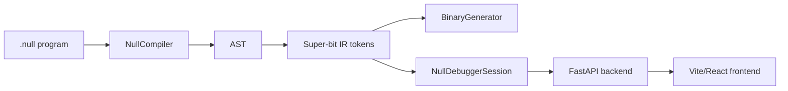

# Execution Visualizer

The execution visualizer is a small, self-contained workspace under `tools/visualizer/`:

- `tools/visualizer/backend/` — FastAPI service that exposes the debugger timeline and step frames.
- `tools/visualizer/frontend/` — Vite + React UI that renders synchronized panes (English → Super-bit IR → binary bytes).

It reuses `null_system.vm.NullDebuggerSession` (JSON-mode) to avoid duplicating instrumentation.

## Architecture



### Five abstraction layers (UI overlay)

1. **English source** — the human-friendly `.null` program.
2. **AST** — structured syntax tree produced by the parser.
3. **Super-bit IR** — opcode/operand token stream executed by the VM.
4. **Binary frames** — serialized bytes written to the executable payload.
5. **Runtime state** — stack/variables/output evolving per instruction.

## Backend API

- `GET /timeline`
  - Returns static metadata: the full source, total step count, and per-step instruction metadata.
- `GET /state/<step>`
  - Returns the execution frame for a single step (stack/variables/output + the current instruction bytes).
- `WS /ws`
  - Sends `{type:"timeline"}` on connect.
  - Accepts `{type:"get", step:n}` and responds with `{type:"frame"}`.
  - Accepts `{type:"play", from:n, delay_ms:m}` to stream frames.

## Using bundled sample data

A small sample session is checked in at:

- `examples/visualizer/sample.session.json`

You can run the backend in “demo mode” by pointing it at that JSON file:

```bash
NULL_VISUALIZER_SESSION_JSON=examples/visualizer/sample.session.json \
  python -m uvicorn tools.visualizer.backend.server:app --port 8000
```

Then run the frontend:

```bash
npm --workspace null-visualizer-frontend run dev
```

## Visualizing a live program

From the repo root:

```bash
nullc visualize examples/comprehensive.null
```

This command:

1. Compiles the `.null` file.
2. Launches the FastAPI backend (setting `NULL_VISUALIZER_SOURCE`).
3. Starts the Vite dev server.
4. Optionally opens your browser.

## Bundling the frontend for static hosting

Build the frontend bundle:

```bash
npm --workspace null-visualizer-frontend run build
```

If `tools/visualizer/frontend/dist/` exists, the backend automatically serves it from `/` (same origin as the API).

For static hosting without the backend, you can host the `dist/` folder and point `VITE_API_URL` at a running backend.
